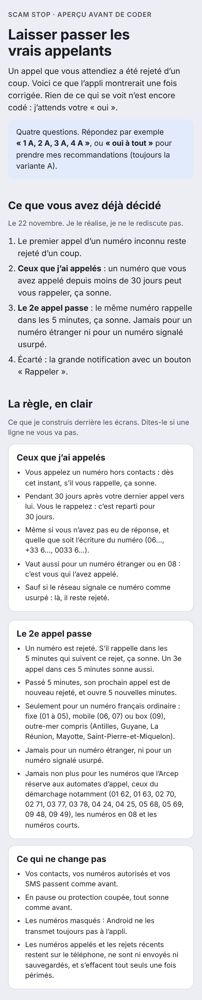
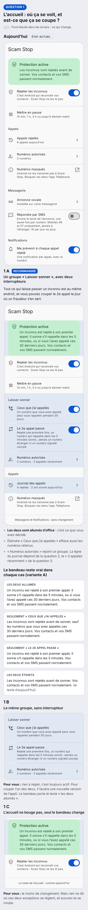
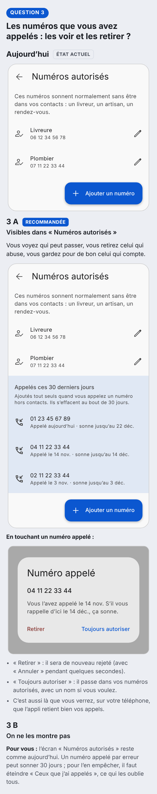
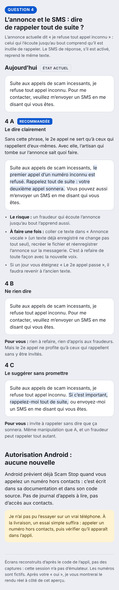

# Laisser passer les vrais appelants : aperçu avant de coder

GitHub n'affiche pas une page HTML : voici la même page en images, à la largeur d'un téléphone.
La page d'origine est [`vrais-appelants.html`](vrais-appelants.html) (statique, sans script, claire et sombre).

Quatre questions. Répondre par exemple « 1 A, 2 A, 3 A, 4 A », ou « oui à tout » : la variante A est chaque fois la recommandation.

Écrans reconstruits d'après le code, numéros fictifs. Rien de ce qui se voit n'est encore codé.

## Ce qui est décidé, et la règle en clair

## Question 1 : l'accueil

## Question 2 : le journal

## Question 3 : les numéros appelés

## Question 4 : l'annonce et le SMS

